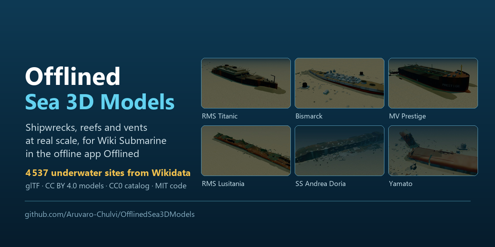

# Offlined Sea 3D Models

*[Read in English](README.md)*

**Modelos 3D abiertos de lo que hay en el fondo del mar —pecios, aviones hundidos, arrecifes, yacimientos
submarinos—, cada uno unido a su artículo de Wikipedia y colocado donde está de verdad, a su tamaño real.**

Un proyecto de [Offlined](https://www.offlined.org), la biblioteca sin conexión con Wikipedia, mapas y el
fondo marino de todo el planeta. En el *Wiki Submarino* de Offlined sobrevuelas el fondo de GEBCO, bajas a un
sitio y lees su artículo; con estos modelos además **verás el pecio ahí tendido**: el Titanic partido en dos a
3.800 m, el Thistlegorm con su carga a 30 m, un U-Boot en el fondo del mar del Norte; y, con un botón, el barco
tal como era flotando justo encima de su pecio, para compararlos.

**[▶ Explora el catálogo en 3D](https://aruvaro-chulvi.github.io/OfflinedSea3DModels/)**: busca cualquier pecio, míralo junto a un
buzo para hacerte una idea del tamaño, abre su artículo de Wikipedia y descarga su modelo genérico como punto de partida
para hacer uno mejor.

## Qué hay aquí

| | |
|---|---|
| [`catalog/catalog.json`](catalog/catalog.json) | **4.537 cosas bajo el mar con artículo en Wikipedia** (en al menos uno de 10 idiomas), con su id de Wikidata, posición, profundidad de GEBCO, tamaño, fechas y familia. Se genera solo a partir de Wikidata + GEBCO. |
| [`models/`](models/) | Los modelos 3D, una carpeta por id de Wikidata. Modelos propios por ahora: **[RMS Titanic](models/item/Q25173/)**, **[Prestige](models/item/Q1977186/)**, **[Bismarck](models/item/Q150857/)**, **[RMS Lusitania](models/item/Q187425/)**, **[SS Andrea Doria](models/item/Q493798/)**, **[Yamato](models/item/Q215010/)**, **[HMHS Britannic](models/item/Q215692/)**, **[Musashi](models/item/Q1127368/)**, **[HMS Hood](models/item/Q220239/)**, el navío **[Mars](models/item/Q31357/)** (1564) el **[Endurance](models/item/Q911858/)** de Shackleton (barcos de madera, hechos con `tools/sailkit.py`), el avión de línea **[Kaleva](models/item/Q1464299/)** (un Ju 52 de 1940, hecho con `tools/airkit.py`) el submarino **[USS Scorpion](models/item/Q1757204/)** y el bombardero **[B-17 «Black Jack»](models/item/L1/)** (una ficha propia del catálogo: no tiene artículo en Wikipedia) y el carguero del mar Rojo **[SS Thistlegorm](models/item/Q32276/)**, con sus camiones, motos y locomotoras: los pecios tal como están hoy y los barcos como eran. |
| [`model_sources/`](model_sources/) | Modelos hechos por código (Python + [`tools/meshkit.py`](tools/meshkit.py)): se ejecuta el script y sale el `.glb`. |
| [`docs/MODEL_SPEC.es.md`](docs/MODEL_SPEC.es.md) | Las reglas que sigue cada modelo (glTF `.glb`, metros, ejes, origen, límites, `meta.json`). |
| [`generator/`](generator/) | El generador de pecios genéricos (JavaScript, three.js): cualquier elemento del catálogo → un modelo a tamaño real, con pintura, óxido y sedimento. Offlined usa el mismo archivo. |
| [`site/`](site/) | La página del catálogo que se publica en GitHub Pages. |
| [`tools/`](tools/) | El generador del catálogo, el lector de profundidades de GEBCO y el comprobador de modelos que se ejecuta en cada *pull request*. |

### El catálogo en cifras

| Familia | Elementos |
|---|---:|
| Submarinos | 1.206 |
| Otros barcos | 1.095 |
| Buques de guerra | 911 |
| Veleros | 267 |
| Vapores | 253 |
| Aviones | 211 |
| Transatlánticos y ferris | 201 |
| Cargueros | 186 |
| Portaaviones | 79 |
| Arrecifes | 67 |
| Petroleros | 44 |
| Pesqueros | 11 |
| Fuentes hidrotermales | 3 |
| Yacimientos y estatuas | 2 |
| Museos submarinos | 1 |

Artículos por idioma: English 4.288 · Français 2.381 · Deutsch 2.053 · Русский 1.258 · العربية 1.072 · Español 1.026 · Italiano 1.005 · Português 1.001 · 中文 853 · हिन्दी 9.

**2.178** pertenecen a una clase de barco conocida, así que un solo modelo de clase sirve para muchos: solo el U-Boot tipo VIIC, **338** pecios.

Aún no están: los pecios de lagos (la malla de GEBCO trata los lagos como tierra) y los sitios cuya ficha de Wikidata no tiene coordenadas.

## Cómo consigue cada pecio su modelo

Nadie puede modelar a mano 4.537 objetos, así que cada pecio recibe el mejor modelo que haya, en este orden:

1. **Su propio modelo** — `models/item/<id>/` — hecho por alguien para ese pecio.
2. **El de su clase** — `models/class/<id>/` — un modelo para todos los barcos del mismo diseño (todos los
   U-Boot tipo VII, todos los Liberty…).
3. **El de su modelo de avión** — `models/vehicle/<id>/` — para los aviones hundidos.
4. **Un modelo genérico** dibujado por código según su familia y su eslora y manga reales (transatlántico,
   buque de guerra, submarino, carguero, petrolero, velero, avión…), tendido en el fondo, escorado, medio
   enterrado y oxidado; siempre el mismo para el mismo pecio. Los arrecifes, fuentes hidrotermales, yacimientos
   y museos submarinos reciben una parcela representativa.

Así el fondo está lleno desde el primer día y mejora con cada aportación.

## Colaborar

Puedes ayudar **sin saber nada de 3D**: corregir una posición, una profundidad o un rumbo, o avisar de algo que
en realidad no está bajo el mar. Y si modelas, un solo modelo de clase puede servir para decenas de pecios.
También se puede mejorar un modelo que ya existe (un Titanic mejor, por ejemplo) con un *pull request*.

Cada aportación pasa por la comprobación automática, la revisión de quien mantiene el proyecto en el visor y, solo
después, una versión publicada: Offlined no descarga nada que no se haya publicado ahí. Mira [CONTRIBUTING.es.md](CONTRIBUTING.es.md#cómo-se-revisan-las-aportaciones).

## Licencias

- **Modelos:** [CC BY 4.0](https://creativecommons.org/licenses/by/4.0/deed.es) (o [CC0 1.0](https://creativecommons.org/publicdomain/zero/1.0/deed.es) si el autor lo prefiere): libres para cualquier uso, también comercial, citando a sus autores.
- **Catálogo y `meta.json`:** [CC0 1.0](https://creativecommons.org/publicdomain/zero/1.0/deed.es).
- **Código:** [MIT](LICENSE).

Detalles, fuentes y cómo citar: [NOTICE.md](NOTICE.md).

Datos: [Wikidata](https://www.wikidata.org) (CC0) · [GEBCO Grid](https://www.gebco.net) (GEBCO Compilation Group).
