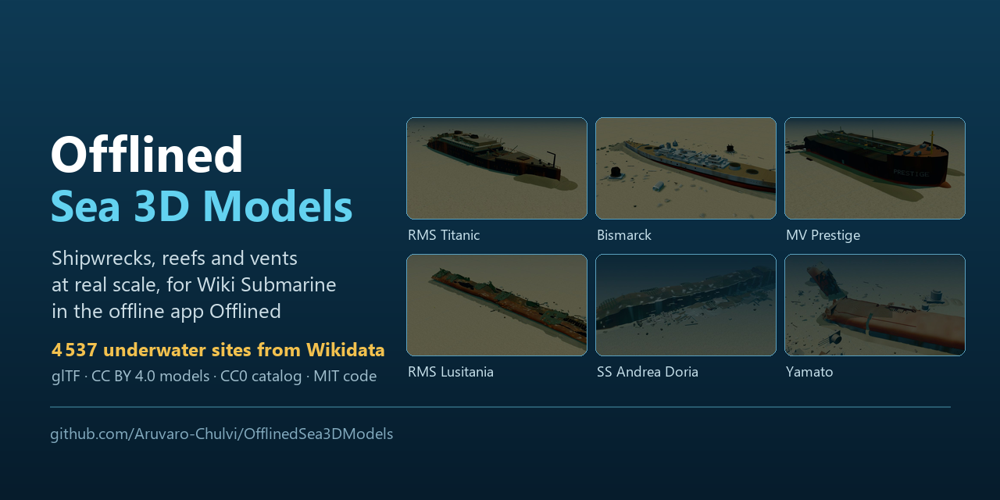

# Offlined Sea 3D Models

*[Leer en español](README.es.md)*

**Open 3D models of what lies on the seabed — shipwrecks, sunken aircraft, reefs, underwater sites — each one
linked to its Wikipedia article and placed where it really is, at real size.**

A project of [Offlined](https://www.offlined.org), the offline library with Wikipedia, maps and the seafloor
of the whole planet. In Offlined's *Wiki Submarine* you fly over the GEBCO seabed, go down to a place and read
its article; with these models you will also **see the wreck lying there**: the Titanic broken in two at
3,800 m, the Thistlegorm with its cargo at 30 m, a U-boat on the North Sea bed — and, with one button, the ship
as she was floating just above her wreck, to compare the two.

**[▶ Browse the catalog in 3D](https://aruvaro-chulvi.github.io/OfflinedSea3DModels/)** — search any wreck, look at it next to a diver
for scale, open its Wikipedia article, and download its generic model as a starting point for a better one.

## What is here

| | |
|---|---|
| [`catalog/catalog.json`](catalog/catalog.json) | **4,537 things under the sea that have a Wikipedia article** (in at least one of 10 languages), with their Wikidata id, position, GEBCO depth, size, dates and family. Built automatically from Wikidata + GEBCO. |
| [`models/`](models/) | The 3D models, one folder per Wikidata id. Own models so far: **[RMS Titanic](models/item/Q25173/)**, **[MV Prestige](models/item/Q1977186/)**, **[Bismarck](models/item/Q150857/)**, **[RMS Lusitania](models/item/Q187425/)**, **[SS Andrea Doria](models/item/Q493798/)** and **[Yamato](models/item/Q215010/)** — the wrecks as they lie today, and the ships as built. The Titanic also has a **[diorama](https://aruvaro-chulvi.github.io/OfflinedSea3DModels/diorama.html#Q25173)**: the wreck on 1 km of North Atlantic floor, with the deep-sea life around it, rusticles, the debris field and 24 points of interest, to look at closely ([how](docs/MODEL_SPEC.md#7-the-diorama-dioramaglb)). |
| [`model_sources/`](model_sources/) | Models built by code (Python + [`tools/meshkit.py`](tools/meshkit.py)): run the script, get the `.glb`. |
| [`docs/MODEL_SPEC.md`](docs/MODEL_SPEC.md) | The rules every model follows (glTF `.glb`, metres, axes, origin, limits, `meta.json`). |
| [`generator/`](generator/) | The generic wreck generator (JavaScript, three.js): any catalog item → a model at real size, with paint, rust and sediment. Offlined uses the same file. |
| [`site/`](site/) | The catalog page published on GitHub Pages. |
| [`tools/`](tools/) | Catalog builder, GEBCO depth reader and the model checker that runs on every pull request. |

### The catalog in numbers

| Family | Items |
|---|---:|
| Submarines | 1,206 |
| Other ships | 1,095 |
| Warships | 911 |
| Sailing ships | 267 |
| Steamships | 253 |
| Aircraft | 211 |
| Liners and ferries | 201 |
| Cargo ships | 186 |
| Aircraft carriers | 79 |
| Reefs | 67 |
| Tankers | 44 |
| Fishing vessels | 11 |
| Hydrothermal vents | 3 |
| Archaeological sites and statues | 2 |
| Underwater museums | 1 |

Articles per language: English 4,288 · Français 2,381 · Deutsch 2,053 · Русский 1,258 · العربية 1,072 · Español 1,026 · Italiano 1,005 · Português 1,001 · 中文 853 · हिन्दी 9.

**2,178** of them belong to a known vessel class — a single class model covers many: the Type VIIC U-boat alone, **338** wrecks.

Not yet included: wrecks in lakes (the GEBCO grid treats lakes as land), and places whose Wikidata entry has no coordinates.

## How a wreck gets its model

Nobody can model 4,537 objects by hand, so every wreck gets the best model available, in this order:

1. **Its own model** — `models/item/<id>/` — made by someone for that wreck.
2. **Its class model** — `models/class/<id>/` — one model for every ship of the same design (all the Type VII
   U-boats, all the Liberty ships…).
3. **Its aircraft type** — `models/vehicle/<id>/` — for sunken aircraft.
4. **A generic model** drawn by code from its family and its real length and beam (liner, warship, submarine,
   cargo ship, tanker, sailing ship, aircraft…), lying on the seabed with a list, half buried and rusted —
   always the same for the same wreck. Reefs, vents, archaeological sites and underwater museums get a
   representative patch.

So the seabed is full from day one, and gets better with every contribution.

## Contributing

You can help **without any 3D skills**: correct a position, a depth or a heading, or point out something that
is not really under the sea. And if you model, a single class model can cover dozens of wrecks.
Anyone can also improve an existing model (a better Titanic, say) with a pull request.

Every contribution goes through the automatic check, a review by the maintainer in the viewer, and only then into
a release — Offlined downloads nothing that has not been published there. See [CONTRIBUTING.md](CONTRIBUTING.md#how-contributions-are-reviewed).

## Licences

- **Models:** [CC BY 4.0](https://creativecommons.org/licenses/by/4.0/) (or [CC0 1.0](https://creativecommons.org/publicdomain/zero/1.0/) if the author prefers) — free for any use, also commercial, crediting the authors.
- **Catalog and `meta.json`:** [CC0 1.0](https://creativecommons.org/publicdomain/zero/1.0/).
- **Code:** [MIT](LICENSE).

Details, sources and how to credit: [NOTICE.md](NOTICE.md).

Data: [Wikidata](https://www.wikidata.org) (CC0) · [GEBCO Grid](https://www.gebco.net) (GEBCO Compilation Group).
